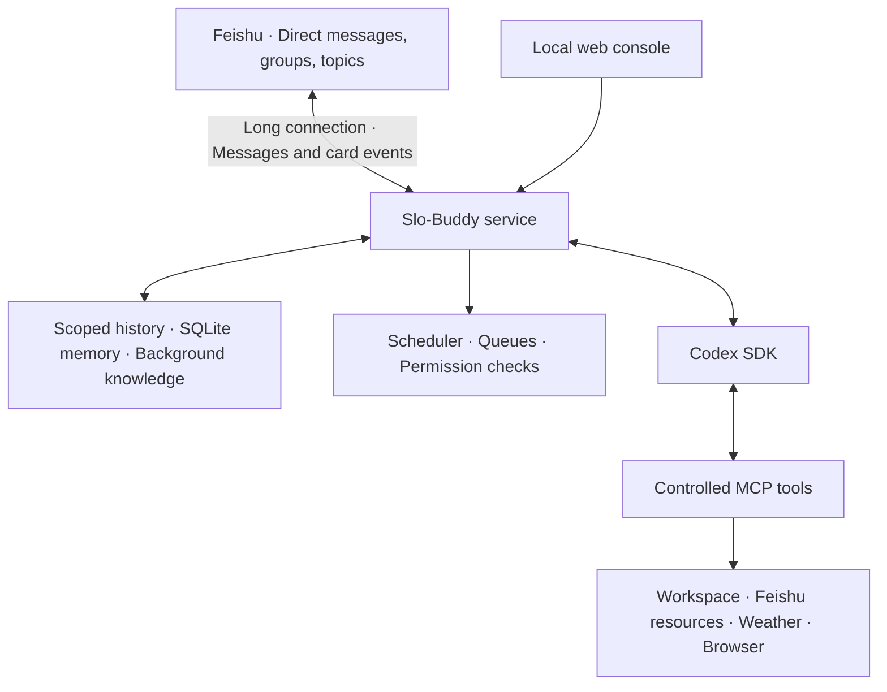

<div align="center">

# Slo-Buddy

**An AI companion for Feishu. Run locally. Configure it your way.**

Conversations, scoped memory, controlled tools, and scheduled tasks — powered by Codex.

[English](README.md) · [简体中文](docs/README-ZH.md) · [Setup guide](docs/SETUP.md) · [Usage guide](docs/USAGE.md)


</div>

Slo-Buddy connects Feishu direct messages, group chats, and topics to a locally running AI service. It gives each installation its own personality, background knowledge, memory, permissions, and automations, managed through a local web console.

It is a source-based application for people comfortable running a Node.js service. Model requests use your own Codex account; Feishu operations use your own application credentials.

## What it does

| Capability | What you can do |
| :--- | :--- |
| **Conversations** | Chat privately or mention the buddy in an authorized group. Keep topic replies inside the original topic. Connect multiple Feishu applications to one service. |
| **Personality** | Configure personality, habits, tone, and group rules. Optionally read your local base instructions. |
| **Memory & knowledge** | Maintain background knowledge and retrieve conversation-scoped facts from local SQLite storage. Let the model request memory updates through controlled tools. |
| **Images & documents** | Understand supported images and references, generate images when supported by your Codex account, work with authorized Feishu documents, and archive selected group images. |
| **Interactive responses** | Send formatted messages, cards with choices, text input or HTTPS link buttons, real member mentions, and progress updates for longer tasks. |
| **Scheduled tasks** | Create, list, pause, resume, and cancel tasks from chat as the paired owner. Run one-off or recurring tasks with time zones, date bounds, read-only AI execution, and conditional notifications. |
| **Controlled tools** | Grant workspace, document, image-generation, and browser capabilities by conversation type. Restrict resources through allowlists. |
| **Local operations** | Manage connections and settings in a web console, inspect recent service events, and run the service in the background on macOS. |

Requests in the same conversation are processed sequentially, with up to 20 waiting requests. Across conversations, the service processes up to three requests concurrently.

## Architecture



The service handles identity, conversation scope, scheduling, and delivery. Codex handles model reasoning and tool selection. Tool access remains subject to Slo-Buddy policies and the permissions granted to the Feishu application.

## Quick start

### 1. Install

You will need **Node.js 22 or later**, Git, a working Codex account, and a Feishu tenant where you can create and publish an application. macOS is the validated environment.

```sh
git clone https://github.com/doudou0o/Slo-Buddy.git
cd Slo-Buddy
npm ci
npm run setup
```

Setup creates local configuration, empty credential files, and runtime directories. It preserves existing configuration when run again.

### 2. Sign in to Codex

Use the CLI installed with the project:

```sh
./node_modules/.bin/codex -c cli_auth_credentials_store='"file"' login
./node_modules/.bin/codex login status
```

The service expects your authentication file in the default Codex home and maintains isolated runtime copies. Your account must support the configured model; change the `model` field in `config/buddy.json` if necessary. Account usage limits still apply.

### 3. Configure Feishu

Create an application in the [Feishu Open Platform](https://open.feishu.cn/), enable its bot capability, and fill in the empty fields in:

```text
.private/apps/main.env
```

Configure long-connection events for `im.message.receive_v1` and, for interactive cards, `card.action.trigger`. Grant the required message permissions, publish the application, and complete any tenant approval requirements.

See the [Feishu setup and permission checklist](docs/SETUP.md#3-创建飞书应用) for details. This guide is currently in Chinese.

### 4. Start and pair

```sh
npm start
```

Open **[http://127.0.0.1:18343/](http://127.0.0.1:18343/)**. Connect your application in the Feishu connections section, then send the displayed pairing command to the bot in a direct message.

Start with a simple message. Enable additional capabilities only after basic messaging works.

> New installations start with a blank personality, no inherited global persona, disabled Feishu connections and browser access, and paused schedule templates. Configure your own applications, groups, locations, and document destinations before enabling tasks.

## Included skills

Skills are project-owned instructions for using the available tools. They are separate from desktop Codex skills and plugins.

| Skill | Purpose |
| :--- | :--- |
| `reminders` | Manage personal reminders and owner-authorized scheduled tasks in the current conversation or topic. |
| `group-image-archive` | Find selected images in the current group, name them using context, and save them to a configured shared folder. |
| `weather` | Query current conditions and forecasts through Open-Meteo. |
| `workspace-files` | List, search, and read permitted workspace files. |
| `feishu-documents` | Create, read, and append to authorized Feishu documents. |
| `meituan-takeaway` | Attempt menu browsing and cart additions using the controlled browser. Stops before checkout, ordering, or payment. |

Browser use requires explicit permission and a local browser installation:

```sh
npx playwright install chromium
```

Third-party sites may block automation or require manual verification. The project does not guarantee access to any ordering platform. Arbitrary third-party skill installation through the web console is not supported.

## Privacy & boundaries

- **Local persistence:** configuration, conversation state, memory, authentication copies, and generated files are stored on your machine and excluded from Git.
- **External processing:** relevant prompts, history, memory, and images may be sent to Codex. Messages and document operations go through Feishu; weather requests go to external weather services. Local hosting does not mean offline inference.
- **Scoped context:** history and memory are separated by application, conversation, and topic. Shared group context is visible to participants in that scope.
- **Explicit permissions:** local tools require Slo-Buddy authorization. Feishu resources also require platform permissions and access to the target resource.
- **Bot loop controls:** optional bot-to-bot replies require an allowlist and use round and cooldown limits.
- **Local administration:** the console binds to loopback. It has no multi-user login or enterprise role system; do not expose it directly to the public internet.

The repository contains no maintainer credentials, personal background knowledge, real member IDs, chat archives, or generated images. See [data locations and distribution boundaries](docs/DATA-AND-RELEASE.md) for the complete list.

## Running in the background

On macOS, stop the foreground process before installing the LaunchAgent:

```sh
npm run service -- install
npm run service -- status
```

To stop it:

```sh
npm run service -- stop
```

Keep the project at its installed location. The service does not wake a sleeping or powered-off computer. Scheduled runs missed by more than five minutes are skipped rather than delivered in a burst.

## Development & distribution

```sh
npm test
npm run package
```

Tests initialize missing local configuration without replacing existing files. They do not establish end-to-end delivery in your own Feishu tenant. `npm run smoke` makes a real Codex request and uses account quota.

The packaging command requires a clean Git working tree and creates a source archive from `HEAD`, with a SHA-256 checksum, under `artifacts/releases/`. A publication allowlist and credential-pattern checks provide additional safeguards. Review your changes before sharing; do not distribute an entire working installation.

## Current limitations

- macOS is validated; Linux and Windows service installers are not included.
- Codex is the current model backend. Separate Claude, other-provider, and local-model adapters are not implemented.
- Local memory uses keyword-based retrieval, not embeddings. Mem0 is shown as an unavailable option.
- Image generation depends on the capabilities available to your account and installed Codex version.
- History and media retrieval are bounded by application access, topic scope, and query limits. It is not a complete historical media index.
- Logs show recent service events, not a complete per-request trace or model-internal reasoning.
- The web console and detailed guides are currently in Chinese. This English README is the entry point for international readers.

## Documentation

| Guide | Contents |
| :--- | :--- |
| [Chinese overview](docs/README-ZH.md) | Chinese-language introduction and quick start |
| [Feature reference](docs/FEATURES.md) | Supported behavior and implementation boundaries |
| [Setup guide](docs/SETUP.md) | Authentication, Feishu permissions, events, pairing, and background service |
| [Usage guide](docs/USAGE.md) | Configuration, tools, memory, and day-to-day operation |
| [Data & releases](docs/DATA-AND-RELEASE.md) | Storage, privacy, backups, and source distribution |

Detailed guides are currently available in Chinese.
